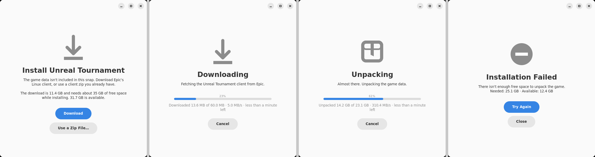
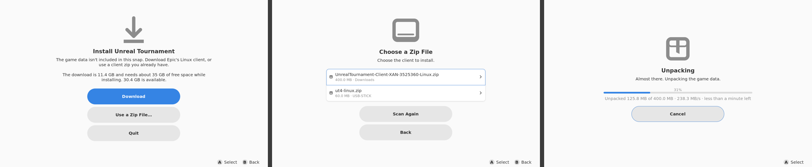

# unrealtournament snap

A strictly confined installer and launcher for the Unreal Tournament (UE4 pre-alpha) Linux client.

Epic's cooked game data may not be redistributed, so **the snap doesn't contain the game**. On
first launch it downloads Epic's last Linux client build from Epic's own CDN, or unpacks a client
zip the user already has. The data goes into the user's snap directory. This follows the same
pattern as installer snaps like `steam` and `quake4-installer`.

## Layout

| Path | Purpose |
| --- | --- |
| `snap/snapcraft.yaml` | core24, strict, `gnome` extension, plus the client's runtime libraries |
| `snap/local/ut-launcher.sh` | Runs the installer on first launch, then starts the game |
| `snap/local/ut-installer.py` | First-run installer: a GTK4/libadwaita window with gamepad support, or terminal output when there's no display |
| `snap/hooks/configure` | Validates the `download-url` option |
| `snap/gui/unrealtournament.desktop` | Desktop entry |

## Installer window

The first launch opens a native GTK4/libadwaita window. It draws directly on Wayland (XWayland
isn't needed) and needs neither a desktop shell nor a mouse. It shows a progress bar with bytes
done, transfer speed and time remaining, first while downloading and then while unpacking.
Cancelling, or closing the window, keeps the partial download, and the next launch offers
**Resume Download**.



### Handhelds and controllers

- **Fullscreen without a desktop.** With no desktop session (a kiosk compositor such as
  ubuntu-frame, gamescope, or Steam's Gaming Mode), the window goes fullscreen with larger text and
  buttons, and adds a **Quit** button. To force this either way, set `UT_INSTALLER_FULLSCREEN=1`
  or `0`.
- **Gamepad navigation.** This uses libmanette and the `joystick` plug. The D-pad or left stick
  moves through the buttons and list rows, **A** selects, and **B** goes back. B does nothing while
  installing, so a stray press can't cancel an 11 GB download. A legend for the A and B buttons
  appears at the bottom while a controller is connected. A keyboard works too: arrow keys, Enter,
  and Escape for back.
- **Choosing a zip needs no file dialog.** "Use a Zip File…" searches the home folder,
  `~/Downloads`, `~/Desktop` and `~/Games`, plus USB drives under `/media`, `/run/media` and
  `/mnt`. It lists only zips that actually contain the UT Linux client, and each one is a single
  button press. If a drive can't be read, the page shows the `snap connect
  unrealtournament:removable-media` command. On a regular desktop with a portal running, there's
  also a **Browse Files…** button that opens the system file chooser.



## Usage

```sh
snapcraft pack
sudo snap install --dangerous unrealtournament_*.snap
sudo snap connect unrealtournament:joystick           # gamepads
sudo snap connect unrealtournament:removable-media    # only to install from a zip on /media

unrealtournament          # installs on first run, then launches
unrealtournament.setup    # reinstall; the old copy is kept until the new one unpacks

# Use a mirror instead of Epic's CDN
sudo snap set unrealtournament download-url=https://mirror.example/UT-Linux.zip
# Headless or terminal install from a local zip
UT_CLIENT_ZIP=~/UnrealTournament-Client-XAN-3525360-Linux.zip unrealtournament
```

## CI

`.github/workflows/snap.yml` builds the snap on every push and pull request, checks that the
launcher, installer and `libgconf-2.so.4` made it in, installs it, and exercises the `configure`
hook. The snap is uploaded as the `unrealtournament-snap` artifact.

Pushing a `v*` tag, or a manual run with **publish** ticked, releases it to the Snap Store (`edge`
by default; a manual run can pick the channel). Publishing runs in the `snap-store` environment and
needs the `SNAPCRAFT_STORE_CREDENTIALS` secret (`snapcraft export-login
--snaps=unrealtournament --acls=package_access,package_push,package_update,package_release -`).
See the store-name caveat below first.

## Client source

The default download is Epic's last Linux client, `Release-Next` CL 3525360 (July 2017):

```
https://s3.amazonaws.com/unrealtournament/ShippedBuilds/%2B%2BUT%2BRelease-Next-CL-3525360/UnrealTournament-Client-XAN-3525360-Linux.zip
```

It was still online as of October 2026 (11.4 GB zip, 23.1 GB unpacked, 1,294 entries). The
project plan named `ut4.timiimit.com/builds/UnrealTournament-Client-Linux.zip`, but that URL
returns an HTML page, not a zip, so the snap doesn't use it.

## How it differs from the original plan, and why

- **Data goes to `$SNAP_USER_COMMON`, not `$SNAP_USER_DATA`.** `$SNAP_USER_DATA` is versioned,
  and snapd copies it on every refresh, which would mean 23 GB per refresh. Config and saves still
  go to `$SNAP_USER_DATA/.config/Epic/UnrealTournament`, because confinement sets `HOME` there.
- **It checks free space before it starts, resumes interrupted downloads, and extracts to a
  staging directory.** A failed or cancelled install never leaves a half-unpacked game behind.
- **It restores the executable bits after unzipping.** Epic's zip was built on Windows and stores
  no Unix permissions, so `UE4-Linux-Shipping` doesn't come out executable.
- **The binary path is `LinuxNoEditor/Engine/Binaries/Linux/UE4-Linux-Shipping`.** The plan used
  a path without the `LinuxNoEditor/` prefix.
- **It stages CEF's dependencies.** The bundled `libcef.so` links NSS, NSPR, XScrnSaver, XTest and
  `libgconf-2.so.4`. Ubuntu dropped gconf after 22.04, so the `gconf-compat` part stages the jammy
  library, pinned by SHA-256.
- **It doesn't set `VK_ICD_FILENAMES` and doesn't stage `mesa-vulkan-drivers`.** UE 4.15 renders
  with OpenGL, and the `gnome` extension's `gpu-2404` stack supplies the drivers.
  `VK_ICD_FILENAMES` takes a list of JSON files, not a directory, so the plan's value would have
  broken Vulkan anyway.
- **It stages `libasound2t64`, not `libasound2`.** `libasound2` is a virtual package on noble and
  can't be staged.
- **`SDL_VIDEODRIVER` defaults to `x11`.** UE 4.15's SDL2 has no Wayland backend.

## Known caveats

- Epic shut down UT4's online services, so the in-game login and matchmaking won't work.
  Offline play, LAN and direct connect are what to test.
- **Store name:** "Unreal Tournament" is an Epic trademark, so registering `unrealtournament` will
  probably need a manual review, or a name such as `unrealtournament-installer`.
- There's no icon yet. Avoid Epic's logo and commission or draw a neutral one.

## QA checklist

- [ ] First-run download, cancel, then resume; first run from a local zip; `unrealtournament.setup`
- [ ] On a handheld (ubuntu-frame or gamescope): the installer is fullscreen, the gamepad works
      from launch, and a controller plugged in while it's running is picked up. Hotplug relies on
      udev events reaching the snap through the `joystick` interface; this hasn't been checked on
      hardware yet.
- [ ] `LIBGL_DEBUG=verbose unrealtournament` uses the host GPU, not llvmpipe
- [ ] Gamepads appear with `joystick` connected
- [ ] OpenAL audio through PipeWire-pulse
- [ ] No AppArmor/seccomp denials (`snappy-debug`, or `journalctl -k | grep DENIED`)
- [ ] LAN and direct-connect server discovery with `network-bind`
